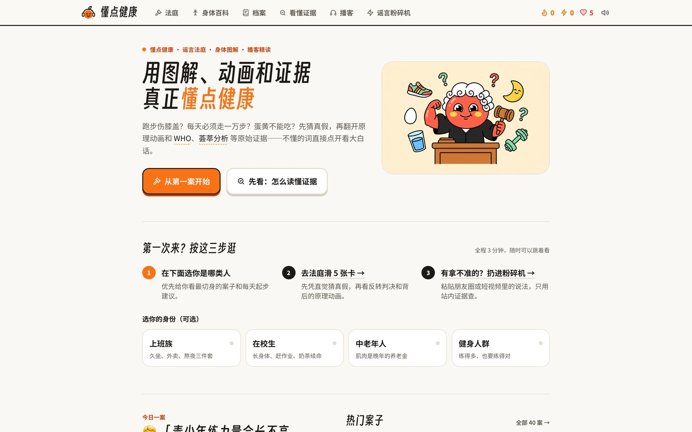
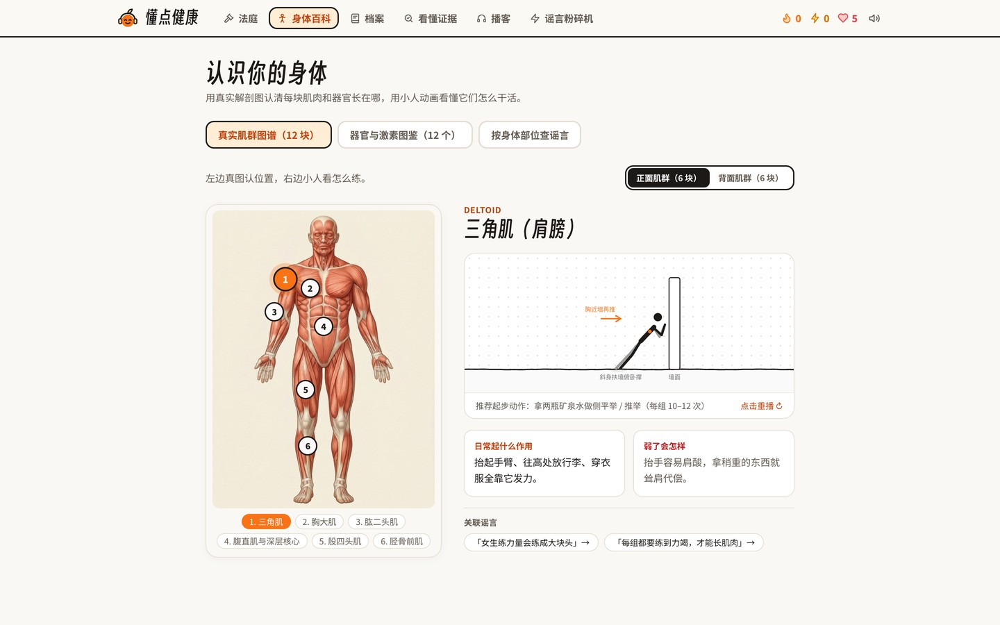
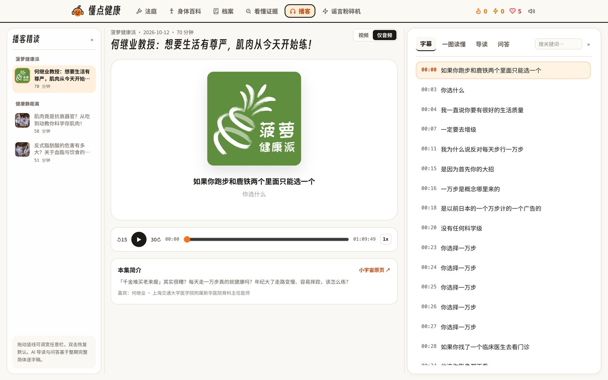
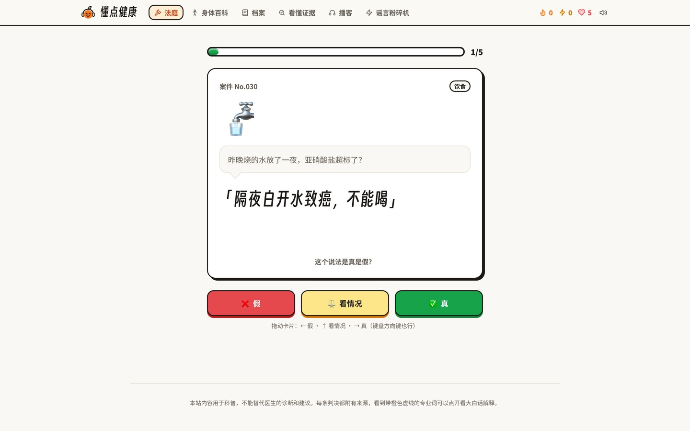

<div align="center">

# 懂点健康 · Health Stone

**用图解、动画和证据，把生活里的健康谣言、身体原理和长篇健康播客变成真正好懂的交互体验。**

<p>
  <a href="https://health.heystone.site/"><strong>立即逛逛 ↗</strong></a> ·
  <a href="https://health.heystone.site/court">谣言法庭</a> ·
  <a href="https://health.heystone.site/body">身体百科</a> ·
  <a href="https://health.heystone.site/podcasts">播客精读</a> ·
  <a href="#english">English</a>
</p>

<br />



</div>

## 为什么做它

朋友圈和短视频里每天都在流传“跑步伤膝盖”“每天必须走一万步”“隔夜水致癌”这类半真半假的说法——查论文门槛太高，看营销号又越看越焦虑。

**懂点健康**换了一种读法：**先凭直觉站队，再翻开原理动画与原始证据**。遇到不懂的医学名词直接点开看大白话，还能把一两小时的硬核健康播客放进三栏精读工作台里，边听边看同步逐字稿、生成 3:4「一图读懂」海报，或让 AI 基于整期逐字稿做导读和问答。

## 核心界面一览

|  |  |
| :---: | :---: |
| *身体百科：12 块真实医学解剖肌群图谱 + 橙线小人动作原理动画* | *播客精读工作台：仿 SubCast 可拖拽三栏、字幕同步、一图读懂与 AI 问答* |

|  |  |
| :---: | :---: |
| *谣言法庭：5 张卡一轮，先选「假 / 看情况 / 真」再看反转判决与来源* | *首页大厅：按上班族 / 在校生 / 中老年人 / 健身人群推荐最切身的案子* |

### 站内全部模块

| 路径 | 你可以体验什么 |
| :--- | :--- |
| `/` | **首页大厅**：选身份标签、今日一案、热门案件与播客推荐 |
| `/court` | **谣言法庭**：5 张卡一轮，支持手势拖动与方向键作答，翻牌看判决与权威出处 |
| `/body` | **身体百科**：12 块真实医学解剖肌群图谱 + 12 位器官与激素角色 + 橙线小人原理动画 |
| `/cases` | **判决书档案室**：40 篇已核验健康谣言深度解析、证据等级与 WHO / 荟萃分析来源 |
| `/podcasts` | **播客精读工作台**：可拖拽全高三栏、简体逐字稿同步滚动、3:4「一图读懂」所见即所得 PNG 导出、流式 AI 导读与多轮问答、跨页悬浮播放 |
| `/smash` | **谣言粉碎机**：粘贴朋友圈或短视频里的说法，基于站内 40 份判决书快速核查 |
| `/guide` | **看懂证据**：三步看懂健康研究证据金字塔 |

## 快速开始

```bash
git clone https://github.com/nuts-and-bytes/health-heystone.git
cd health-heystone
npm install
cp .env.example .env.local   # 可选：填入 OPENAI_API_KEY 开启播客流式 AI 导读与问答
npm run dev
```

<details>
<summary><strong>技术栈、Vercel 部署与科普边界</strong></summary>

<br />

- **技术栈**：Next.js 16 · React 19 · TypeScript · Tailwind CSS 4 · `@base-ui/react` · Motion
- **部署到 Vercel（`health.heystone.site`）**：
  1. 在 Vercel 导入本仓库（自动识别为 Next.js）。
  2. 在 **Settings → Environment Variables** 配置 `OPENAI_API_KEY` 与 `OPENAI_MODEL`（默认 `gpt-4o-mini`）。
  3. 绑定自定义域名 `health.heystone.site` 即可自动签发 HTTPS 证书。
- **科普边界**：本站内容仅用于健康科学普及，不能替代执业医生的专业诊断与治疗建议。
- **许可**：采用 [MIT License](LICENSE)。

</details>

## English

**Health Stone (懂点健康)** is an interactive health-science & podcast study web app built with Next.js 16, React 19, Base UI, and Motion. Take a stance first in the **Rumor Court**, inspect 12 anatomical muscle maps paired with stick-figure motion explainers, browse 40 evidence-graded case files, and study long-form health podcasts in a resizable 3-pane workbench with synced transcripts, 3:4 visual summary PNG exports, and streaming AI Q&A.

- [Visit health.heystone.site ↗](https://health.heystone.site/)
- Run locally: `npm install && cp .env.example .env.local && npm run dev`.

---

<p align="center">made by <a href="https://heystone.site/">stone</a> · 为 AI 世界留一点人味</p>
